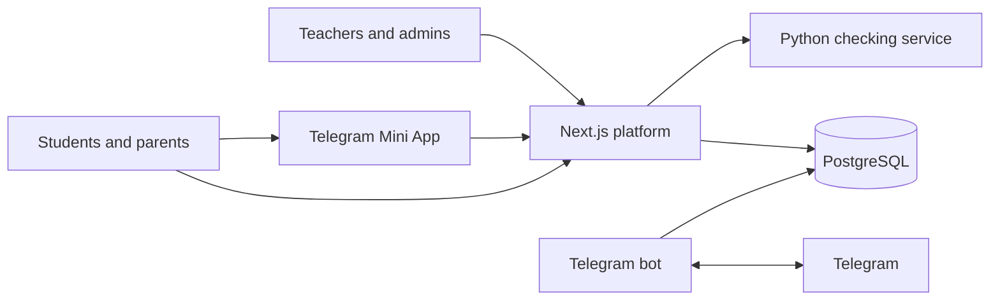

# SmartAcademy

**A classroom assessment platform for building tests, running online and paper
exams, and helping teachers follow student progress.**

SmartAcademy combines a question bank, teacher-led classrooms, online tests,
personalized answer sheets, automated scan checking, and a Telegram bot. A
teacher can create an assessment once, assign it to a class, and review results
by student, question, and topic.

> **Scope:** this repository contains a web application and Telegram bot. It
> does not contain a native Android application.

## Highlights

- **Question bank:** create questions, organize them by subject and topic,
  import Word documents, or prepare drafts from scanned pages with OCR.
- **Classrooms:** manage students, teacher access, assignments, and student or
  parent account links.
- **Online assessments:** schedule tests, set time limits, randomize questions
  and choices, and choose when answers are released.
- **Paper assessments:** generate personalized answer sheets, scan completed
  sheets, and review the automatically detected answers.
- **Learning insights:** explore classroom, student, topic, and question
  results; suggest practice using topics that need more attention.
- **Telegram:** offer a student and parent cabinet in a Mini App and deliver
  configured assessment and result notifications.

## Architecture



| Directory | Responsibility |
| --- | --- |
| `src/` | Next.js application, authentication, and API routes |
| `prisma/` | PostgreSQL schema, migrations, and seed script |
| `smartbot/` | Python Telegram bot and bot workflows |
| `checker/` | Python service for OMR answer-sheet checking and OCR |
| `scripts/` | Development helpers, data import, and end-to-end checks |
| `deploy/` | Example service, proxy, and database configuration |

The checker is designed for private, local-network access. It does not connect
to the database; the web application validates requests and stores results.

## Stack

- Next.js 16, React 19, TypeScript, and NextAuth
- PostgreSQL and Prisma
- Python 3.12 and aiogram
- aiohttp, OpenCV, PyMuPDF, WeasyPrint, and Tesseract OCR
- GitHub Actions, TypeScript tests, and Python unit tests

## Local development

### Prerequisites

- Node.js 20.9 or newer
- PostgreSQL
- Python 3.12 or newer
- Tesseract with Uzbek and English language data for OCR
- WeasyPrint system dependencies for PDF generation

For platform-specific checker requirements, see [checker/README.md](checker/README.md).

### Start the web platform

1. Install packages and create a local environment file:

   ```bash
   npm ci
   cp .env.example .env
   ```

   In PowerShell, use `Copy-Item .env.example .env`.

2. Set `DATABASE_URL`, `AUTH_SECRET`, and `SEED_SUPERADMIN_PASSWORD` in `.env`.
   Generate a unique secret with `openssl rand -base64 32`; choose a strong,
   unique administrator password. Use only development credentials.

3. Create the local schema and administrator:

   ```bash
   npx prisma migrate deploy
   npm run db:seed
   ```

4. Start the app:

   ```bash
   npm run dev
   ```

   Visit `http://localhost:3000`. A development-only student sign-in page is
   available at `/login/student/dev`.

### Start the answer-sheet checker

Paper test generation and scanning require the checker. Create
`checker/.env` from `checker/.env.example`, set unique `CHECKER_TOKEN` and
`QR_SECRET` values, and use the same `CHECKER_TOKEN` in the platform `.env`.

```bash
cd checker
python -m venv .venv
python -m pip install -r requirements.txt
python server.py
```

The service listens on `127.0.0.1:8090` by default. Do not expose it directly
to the public internet.

### Start the Telegram bot (optional)

Create `smartbot/.env` from `smartbot/.env.example`. Configure a dedicated
development bot token, database URL, QR signing key, and your own Telegram
admin ID before running:

```bash
cd smartbot
python -m venv .venv
python -m pip install -r requirements.txt
python bot.py
```

For Mini App sign-in, Telegram requires a public HTTPS URL and the matching
bot domain configuration. See [smartbot/README.md](smartbot/README.md).

## Tests and checks

```bash
npm test
npm run lint
npx tsc --noEmit
python -m compileall -q smartbot checker
```

Python unit tests:

```bash
cd checker
python -m unittest discover -s tests -t .

cd ../smartbot
python -m unittest discover -s tests -t .
```

Some end-to-end scripts require a running local database and services; see
`scripts/e2e-*.ts`.

## Security and student privacy

- Keep real credentials in local `.env` files or a secret manager, never in
  source control. Use separate, randomly generated values for each environment.
- Staff and student sessions are distinct; staff routes apply role and
  ownership checks.
- Telegram login payloads are verified server-side. Password sign-in can use
  Telegram one-time codes.
- Keep the checker bound to localhost or a private network and protect it with
  a strong shared token.
- Student identities, exam scans, results, exports, and backups are private
  data. Use fictional records in screenshots and demos.

These safeguards are not a security certification. Review access controls,
data retention, and deployment settings before using the software with real
students.

## Project notes

- [Architecture decisions](docs/DECISIONS.md)
- [Demo walkthrough](docs/DEMO.md)
- [Self-hosting overview](docs/DEPLOY.md)
- [Telegram bot](smartbot/README.md)
- [Checker service](checker/README.md)

## License

No license is included. All rights remain with their respective owners; ask
the project owner for permission before reusing this code.
